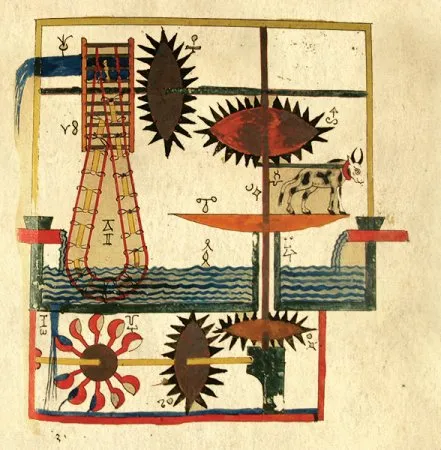

# Al-Jazari's Saqiya - 3D-Printable Model

<<<<<<< HEAD
A 3D-printable model of the animal-driven saqiya (water-raising wheel) described by Ismail al-Jazari in his Book of Knowledge of Ingenious Mechanical Devices (1206).
=======

🚧 **Coming soon!**

A 3D-printable recreation of the animal-driven *saqiya* (water-raising wheel) described by Ismail al-Jazari in his *Book of Knowledge of Ingenious Mechanical Devices* (1206).
>>>>>>> 5fa2603 (Add manuscript illustration to README)

The model is being designed in Autodesk Fusion 360. Files, a build script and assembly instructions will be added here soon.
